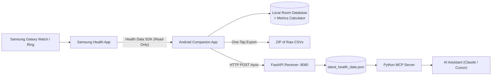

# 🫀 Samsung Health Companion & MCP Bridge

[](https://kotlinlang.org)
[](https://developer.android.com)
[](https://developer.android.com/jetpack/compose)
[](https://modelcontextprotocol.io)
[](https://fastapi.tiangolo.com)
[](LICENSE)

A privacy-focused Android companion application and **Model Context Protocol (MCP)** server that bridges your **Samsung Health** wearable vitals directly to AI assistants (Claude, Cursor, Codex, Antigravity) and offers deep on-device physiological metrics with full raw CSV data export.

---

## 🌟 Key Features

- **🛡️ 100% Read-Only & Privacy-First:** Interacts strictly via read-only scopes using the official Samsung Health Data SDK. No health permissions are requested until you explicitly tap connect.
- **⚡ On-Device Physiological Metrics Engine:** Calculates Garmin-like metrics locally without sending raw health data to any proprietary cloud:
  - **Body Battery** (Real-time dynamic energy state from sleep & activity)
  - **Training Status & Load Ratio** (Acute vs Chronic Workload Ratio)
  - **Recovery Time** (Dynamic recovery hours needed)
  - **VO2 Max Estimation & HRV Status**
- **🤖 Model Context Protocol (MCP) Server:** Exposes your live vitals (`get_live_vitals`, `get_health_summary`) as native MCP tools to Claude Desktop, Cursor, Antigravity, or other LLMs over stdio.
- **📦 Comprehensive Raw Data Exporter:** One-tap export to a structured `.zip` containing organized CSVs covering heart rate, sleep stages, second-by-second workout HR, GPS routes, SpO2, blood pressure, glucose, body composition, and temperature.
- **🔄 Live & Background Cloud Sync:** Push health summaries to your personal MCP endpoint via manual trigger or background sync workers (`WorkManager`).

---

## 🏗️ Architecture & Data Flow



---

## 🛠️ Tech Stack

### Android Client
- **Language:** Kotlin 2.0 (with KSP)
- **UI:** Jetpack Compose + Material 3 Design
- **SDK:** Samsung Health Data SDK (`1.1.0`)
- **Database:** Room Database (SQLite with Flow coroutine streams)
- **Background Tasks:** AndroidX WorkManager
- **Networking:** OkHttp 4 + Gson
- **Architecture:** Clean Architecture (Use Cases, Repository Pattern, Coroutines/Flow)

### MCP Server & Ingestion Bridge
- **Language:** Python 3.10+
- **Protocol:** Model Context Protocol (MCP SDK) over `stdio`
- **Receiver:** FastAPI + Uvicorn (HTTP POST endpoint with Bearer token authentication)

---

## 📊 Supported Health Metrics

| Metric | Resolution | Export Format |
|---|---|---|
| **Heart Rate** | Continuous / On-demand | `02_heart_rate.csv` |
| **Sleep & Sleep Stages** | Awake, REM, Light, Deep + Sleep Score | `05_sleep.csv`, `06_sleep_stages.csv` |
| **Workouts** | Distance, Pace, Calories, Power, Cadence | `11_workouts.csv` |
| **Workout HR Series** | Second-by-second breakdown | `12_workout_hr.csv` |
| **Workout GPS** | Latitude, Longitude, Altitude, Accuracy | `13_gps.csv` |
| **Blood Oxygen (SpO2)** | Sleep & manual spot checks | `08_spo2.csv` |
| **Body Composition** | Weight, BMI, Body Fat %, Muscle Mass, BMR | `10_body_composition.csv` |
| **Blood Pressure** | Systolic, Diastolic, Pulse | `20_blood_pressure.csv` |
| **Blood Glucose** | Blood sugar readings | `21_glucose.csv` |
| **Skin / Core Temperature** | Temperature records | `22_temperature.csv` |
| **Energy Score** | Daily readiness score | `19_energy.csv` |

---

## 🚀 Getting Started

### 1. Prerequisites
- Physical Samsung Galaxy smartphone running **Samsung Health 6.30.2+** *(Emulators do not support Samsung Health Data SDK)*
- Android Studio Ladybug / Meerkat (or newer) with JDK 17+
- Python 3.10+ (for the MCP server)

---

### 2. Android App Setup

1. **Clone the repository:**
   ```bash
   git clone https://github.com/himeshsahoo/samsung-health-companion.git
   cd samsung-health-companion
   ```

2. **Add Samsung Health Data SDK:**
   - Download `samsung-health-data-api-1.1.0.aar` from the [Samsung Developer Portal](https://developer.samsung.com/health).
   - Place the file in `app/libs/`:
     ```bash
     app/libs/samsung-health-data-api-1.1.0.aar
     ```

3. **Enable Developer Mode in Samsung Health on your phone:**
   - Open **Samsung Health** on your phone.
   - Go to **Settings > About Samsung Health**.
   - Tap the **Version** number rapidly 10 times until the Developer Mode prompt appears.
   - Turn **Developer Mode** ON.

4. **Build and Install:**
   - Open the project in Android Studio.
   - Sync Gradle and run the app on your physical device.
   - Tap **Sync** to request read permissions and load your data.

---

### 3. Setting Up the MCP Server

The MCP server allows AI assistants (such as Claude Desktop) to inspect your vitals and answer questions about your health, recovery, and sleep.

1. **Navigate to the server directory and set up a virtual environment:**
   ```bash
   cd mcp-server
   python -m venv venv
   # On Windows:
   venv\Scripts\activate
   # On macOS/Linux:
   source venv/bin/activate
   ```

2. **Install dependencies:**
   ```bash
   pip install -r requirements.txt
   ```

3. **Configure environment variables:**
   Copy `.env.example` to `.env`:
   ```bash
   cp .env.example .env
   ```
   Set your secret token:
   ```env
   SYNC_AUTH_TOKEN=your_secure_bearer_token_here
   RECEIVER_PORT=8080
   RECEIVER_HOST=0.0.0.0
   ```

4. **Configure your AI Assistant (e.g., Claude Desktop):**
   Add the server to your `claude_desktop_config.json`:
   ```json
   {
     "mcpServers": {
       "samsung-health": {
         "command": "python",
         "args": [
           "/path/to/samsung-health-companion/mcp-server/health_mcp.py"
         ],
         "env": {
           "SYNC_AUTH_TOKEN": "your_secure_bearer_token_here"
         }
       }
     }
   }
   ```

5. **Sync from the Android App:**
   - In the app, configure your receiver endpoint: `http://<YOUR_COMPUTER_IP>:8080/sync` with token `your_secure_bearer_token_here`.
   - Tap **Live ChatGPT Sync** to push the latest vitals to your MCP server!

---

## 🔒 Security & Privacy

- **No Hardcoded Credentials:** Authentication tokens and endpoints are strictly configured through environment variables or secure app settings.
- **Proprietary Binaries Excluded:** Official Samsung Health SDK `.aar` binaries and personal data cache files (`latest_health_data.json`) are deliberately excluded from version control via `.gitignore`.
- **Local-First Processing:** Physiological metrics (Body Battery, Training Load, Recovery Hours) are computed on-device in Kotlin.

---

## 📄 License

This project is open-source under the [MIT License](LICENSE). 

*Note: Samsung Health and Samsung Health Data SDK are registered trademarks and property of Samsung Electronics Co., Ltd. This project is an independent community tool and is not officially affiliated with or endorsed by Samsung.*
